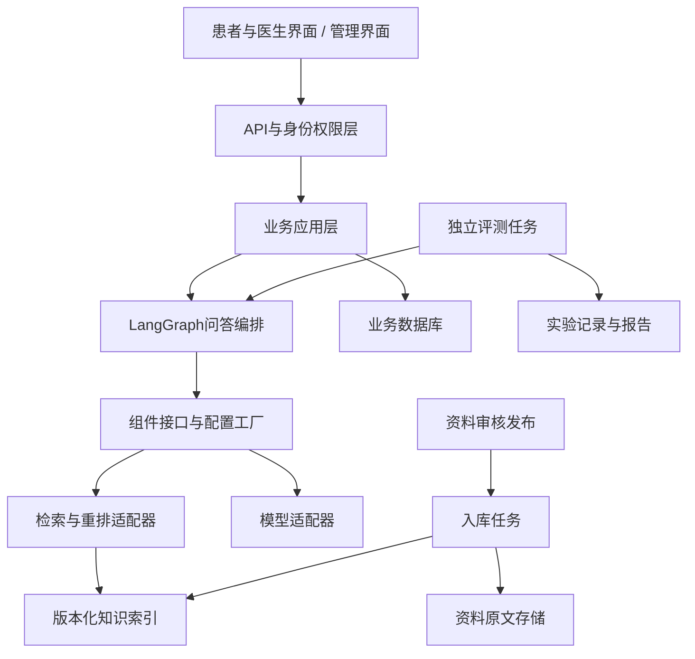
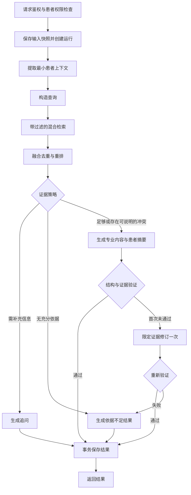

# 耳鼻喉科医疗知识检索问答系统开发文档

当前验收状态：[统一验收总表3.1](统一验收总表交付清单3.1.md)。本设计中的目标要求与已有工程实现分开记录，不能以阶段交付等同整体完成。

版本：v0.1｜日期：2026-10-19｜状态：开发设计初稿

本文是后续实现与技术评审的基础。已确认需求、建议实现与待定事项分别标注；建议指标不等于院方验收承诺。本文 v0.1 编写时项目目录为空。

实施进度更新（2026-10-20）：M0已完成，M1/M2已有本地开发资料治理、检索与引用回答实现；审核及开发版本页面见[1.6交付清单](开发资料版本管理页面交付清单1.6.md)。M3账号及存储见[1.7交付清单](账号授权与患者资料后端交付清单1.7.md)，资料与授权页面见[1.8交付清单](患者资料与授权页面交付清单1.8.md)，咨询保存及答案历史见[1.9交付清单](患者咨询与答案历史交付清单1.9.md)，持久后台队列、进度及人工恢复见[2.0交付清单](咨询后台任务与失败恢复交付清单2.0.md)。M3当前使用独立SQLite开发适配器，仅用于合成信息，尚未接医院账号、真实患者或PostgreSQL生产库。后文正式部署及未交付功能仍为目标设计。

## 1. 项目目标与范围

### 1.1 已确认需求

- 最终目标为医院正式上线；首期聚焦耳鼻喉科医疗知识库 RAG。
- 同时面向患者与医生，两类用户查看同一份答案。
- 答案先呈现专业资料、结合患者输入的解释和引用依据，最后附患者易懂版。
- 患者信息通过结构化表单和文本粘贴输入，并保存至数据库。
- 患者仅访问本人记录；医生仅访问经授权或分配的患者记录；管理员权限独立。
- 知识资料由项目负责人寻找并审核。院方负责后续验收，具体流程暂缓细化。
- 依据不足时说明或追问，不使用模型自身知识补成确定结论；资料冲突时并列引用并说明差异。
- 使用 LangGraph 编排；RAG 组件可插拔；支持充分评测及组件对比实验。
- 当前没有真实患者数据、医院接口或院方测试环境。
- 部署位置、模型服务方式与数据出院边界暂未确定。

### 1.2 首期交付边界

首期实现知识资料管理、审核发布、患者信息管理、问答、引用回溯、访问控制、运行记录与离线评测闭环。

本期不默认包含：HIS/EMR/LIS/PACS 接口、FHIR/DICOM 接入、报告图片 OCR、语音转写、自动病历书写、处方生成、疾病诊断、自动检查推荐、模型预训练、基因或可穿戴设备数据处理。它们来自总体项目材料，但不属于已确认的首期范围。

上线目标保留；本地可运行、模拟数据测试与医院正式上线是不同里程碑。开发初期使用合成患者信息，不能以演示成功代替临床质量或院方验收。

## 2. 角色与业务流程

| 角色 | 首期能力 | 权限边界 |
| --- | --- | --- |
| 患者 | 维护本人输入、发起咨询、查看本人历史与引用 | 禁止访问其他患者记录 |
| 医生 | 对授权或分配患者发起咨询、查看相应记录 | 服务端检查授权及有效期 |
| 资料审核者 | 校核资料、发布与撤回版本 | 独立能力权限，可由项目负责人承担 |
| 管理员 | 账号、角色、配置及运行管理 | 不因管理员身份自动获得患者正文读取权 |

医生分配、患者授权的办理流程及机构身份核验方式待定。设计中使用统一访问授权记录，保留授权来源、范围、有效期与撤销时间。

### 2.1 咨询流程

1. 登录后选择具有访问权限的患者与会话。
2. 填写本次症状和基本情况，或粘贴文本。缺失字段保持未知，不能由模型猜测。
3. 服务端校验权限、输入长度和格式，保存本次患者信息快照。
4. 从快照提取与本次问题相关的信息，构造检索查询。
5. 仅在已发布、有效且当前主体可访问的知识范围内检索。
6. 检查证据充分性和冲突；需要补充信息时返回明确追问。
7. 生成统一答案，检查引用与结构；验证通过后保存并展示。
8. 返回历史记录、资料定位和反馈入口。

### 2.2 资料流程

资料登记 → 原文件保存 → 解析 → 清洗/切块 → 审核 → 构建候选索引 → 验证 → 发布版本。

首期建议支持文本型 PDF、Markdown、TXT；扫描 PDF 检测后标记无法可靠解析，不能当作空文档成功入库。DOCX 与 OCR 可后续通过解析插件扩展。

## 3. 总体架构

建议采用模块化单体起步，API 服务与入库/评测后台任务可独立运行。先建立模块边界，业务和规模需要时再拆服务。



### 3.1 技术建议与未决选择

| 层级 | 当前建议 | 状态 |
| --- | --- | --- |
| 服务端 | Python、FastAPI、Pydantic | 建议；实施时锁定兼容版本 |
| 编排 | LangGraph StateGraph，显式节点与条件边 | 已确认 LangGraph |
| 数据库 | PostgreSQL、迁移工具；业务表与 checkpoint 分离 | 建议 |
| 初始向量存储 | PostgreSQL + pgvector，保留其他存储适配器 | 建议，需语料规模与基准验证 |
| 稀疏检索 | 独立中文关键词/BM25 适配器 | 必须与中文实际语料验证 |
| 前端 | TypeScript + React | 建议，尚未锁定 |
| 资料存储 | 本地开发目录；生产采用独立文件/对象存储接口 | 生产实现待部署决策 |
| 模型、Embedding、重排 | 配置化适配器，提供 Fake 实现用于测试 | 具体模型待评测与部署决策 |
| 运行观测 | 本地结构化指标与脱敏追踪，可接观测后端 | 外部遥测默认关闭 |

本地开发不依赖付费模型或云端评测平台。Fake 适配器只验证工程链路，不用于宣称医学回答质量。

## 4. 可插拔组件契约

业务层与图节点依赖项目定义的接口和 DTO，不直接依赖某一家模型或数据库的 SDK。供应商对象留在 adapters 内。

| 接口 | 输入 → 输出 | 必要约束 |
| --- | --- | --- |
| DocumentParser | 原文件 → 带页码/章节/位置的段落 | 保留来源定位和解析告警 |
| Chunker | 段落 → Chunks | 稳定 ID、来源范围、切块配置版本 |
| Embedder | 文本批次 → 向量批次 | 声明模型版本、维度、归一化方式 |
| VectorIndex | 向量、过滤条件 → 检索结果 | 支持索引版本、删除、权限过滤 |
| SparseRetriever | 查询、过滤条件 → 检索结果 | 中文检索可用，同样执行权限过滤 |
| Retriever | 查询与检索上下文 → RankedChunks | 可组合向量与稀疏检索 |
| Reranker | 查询、候选集 → 排序结果 | 保留原 chunk_id 与证据来源 |
| EvidencePolicy | 候选证据 → 回答/追问/依据不足/冲突 | 策略和阈值可版本化 |
| Generator | 问题、最小患者摘要、证据 → 结构化草稿 | 无权自行查询患者数据库 |
| AnswerValidator | 草稿、证据 → 验证结果 | 结构、引用、支持关系分别检查 |
| Evaluator | 样本、运行产物、标注 → 指标与明细 | 不修改待测答案，不污染正式业务数据 |

### 4.1 统一 DTO 建议

- `PatientContext`：年龄/年龄段、主诉、部位、持续时间、伴随症状、相关病史、用药/过敏信息、粘贴文本。仅收集与场景相关字段；不强制收集全部字段。
- `Chunk`：chunk_id、document_version_id、正文、页码、章节、字符范围、内容校验和、审核状态、权限标签。
- `RetrievalContext`：由服务端构造的机构/知识范围、允许访问范围、索引版本、过滤条件与 top_k。
- `RankedChunk`：Chunk 引用、各检索分数、融合分数、重排分数；不同来源的原始分数不能直接当作同一标尺。
- `Answer`：status、professional_sections、patient_summary、citations、missing_information、conflicts、limitations。
- `RunManifest`：代码版本、图版本、配置哈希、资料/索引快照、提示词版本、模型与插件版本、时间、耗时、用量及错误。

### 4.2 替换规则

1. 通过白名单注册表映射插件 ID 到实现；禁止由用户参数动态导入任意类或执行代码。
2. 替换重排器或生成模型，不应改动图拓扑和业务 API。
3. 替换切块方法或 Embedding 必须构建新索引。即使向量维度相同，也不能假设模型的向量空间兼容。
4. 发布时原子切换索引别名；进行中的请求绑定原快照，保留可回滚版本。
5. 显式配置超时、重试、候选数、上下文预算和版本；请求内不热切换版本。
6. 每个插件必须通过契约测试，错误统一转换为类型化错误，不吞异常。

配置示意（插件 ID 为目标设计名称，不表示对应实现已经存在）：

```yaml
profile: local-development
graph: ent-rag-v1
knowledge_snapshot: ent-approved-v1
plugins:
  parser: text-document-v1
  chunker: section-aware-v1
  embedder: fake-embedding-v1
  vector_index: pgvector-v1
  sparse_retriever: chinese-bm25-v1
  retriever: hybrid-rrf-v1
  reranker: passthrough-v1
  generator: fake-generator-v1
  evaluator: local-suite-v1
limits:
  retrieval_candidates: 30
  context_chunks: 8
  max_validation_repairs: 1
telemetry:
  external_export: false
```

候选数只是开发初值，应通过对照实验调整。凭据通过环境或密钥管理注入，不进入配置文件、RunManifest 或 Git。

## 5. LangGraph 工作流

采用显式工作流，不让模型自主决定数据库权限和任意工具调用。StateGraph 通过状态、节点与边组织处理步骤，具体 API 使用以实施时官方文档与锁定版本为准。[参考 1]



### 5.1 状态与隔离

- Graph state 记录 run_id、输入快照引用、最小患者摘要、问题、查询、候选证据、验证结果与执行状态。
- 登录主体、权限范围和密钥放在服务端运行上下文中；不能让模型输入覆盖。
- 业务历史表是真实业务记录；LangGraph checkpoint 仅用于恢复执行，不能代替病患信息和授权表。[参考 2]
- checkpoint 按机构、患者、会话和运行隔离；thread_id 必须由服务端生成并校验归属。
- 恢复和返回结果前再次核验权限及知识有效性，防止运行期间授权或资料被撤回。
- 状态采用独立输入/输出 DTO。前端不得直接接收图状态、调试事件或所有 streaming values；内部字段不会因为命名为 private 就自动脱敏。[参考 1]

### 5.2 故障与幂等

检索或模型调用失败返回可识别错误，不能伪装成“资料不足”。网络重试仅针对可重试错误，使用退避、截止时间和次数限制。每次咨询有幂等键，最终答案写入以 run_id 唯一约束防止恢复后重复插入。

首期可先返回经验证的完整答案；如添加流式交互，先流转安全状态提示，最终医学正文在验证后展示，避免把未校验草稿作为正式结果。

## 6. 知识治理与答案约束

### 6.1 资料元数据

每份资料记录标题、作者/机构、来源链接、获取时间、出版日期、版本、适用人群/范围、授权说明、审核人、审核时间、状态及撤回原因。状态包括 draft、reviewed、published、withdrawn。

索引必须绑定 document_version 和审核结果。未审核或撤回内容不得通过搜索、缓存、引用接口重新暴露。撤回后清理在线缓存并禁止新请求使用；历史答案保留审计记录并标明相关来源已撤回。

首期按标题和段落结构切块，保留原文定位，避免拆散表格、条件和限定语。切块策略的优劣通过检索评测决定，不能仅凭固定字符长度判断。

### 6.2 回答格式

1. **相关专业资料**：列出与问题相关的结论和适用条件，在具体断言旁引用证据。
2. **结合输入的解释**：明确哪些是患者自述，哪些有资料支持；缺失信息不推断为阴性。
3. **依据与差异**：展示标题、版本/日期、页码/章节、原文片段；说明冲突与适用范围。
4. **患者易懂版**：与专业部分语义一致，不增加新的诊疗结论。
5. **不足与补充信息**：必要时解释无法回答的部分，列出最少必要追问。

引用使用服务端候选集中分配的 evidence_id；模型不能自行构造任意文件路径、链接或未检索来源。引用接口再次验证权限。输出资料不得被当作系统指令执行；资料中的“忽略规则”等内容只作为待检索文本处理。

### 6.3 验证与证据判定

先做确定性检查：结构字段、引用 ID 存在性、资料状态、定位可解析、上下文长度。再做支持关系检查：核心断言是否被引文支持、患者摘要是否新增结论、冲突是否遗漏。模型判分是辅助信号，不把它等同于医学事实验证。

不得把单个相似度分数直接作为“医学可信度”。充分性策略结合已标注样本校准，输出 answered、needs_information、insufficient_evidence、conflicting_evidence 等明确状态。

## 7. 数据库与数据生命周期

以下为建议逻辑表，具体列型和迁移在实现阶段确定。主键建议使用不可预测 ID，时间字段统一存储 UTC，展示转换为 Asia/Shanghai。

| 表 | 关键字段与关系 |
| --- | --- |
| users / roles / user_roles | 用户、角色、账号状态、机构归属 |
| patients / patient_user_links | 患者实体、与登录用户的绑定；绑定流程待确认 |
| patient_access_grants | patient_id、grantee_id、来源、范围、有效期、撤销时间、操作人 |
| consultations | patient_id、创建人、状态、创建时间 |
| patient_context_snapshots | consultation_id、结构化输入、粘贴文本、版本、创建人 |
| messages | consultation_id、角色、内容、对应快照、时间 |
| documents / document_versions | 资料身份、来源、授权、审核、状态、文件引用与校验和 |
| chunks / index_versions | 资料版本、位置、切块版本、索引清单、Embedding 信息 |
| rag_runs | message_id、快照、幂等键、状态、配置/代码版本、运行清单、错误类型 |
| answers / answer_citations | run_id 唯一、结构化答案、引用版本与位置、验证状态 |
| audit_events | 主体、动作、资源 ID、结果、时间、关联 run_id；不记录患者正文 |
| evaluation_datasets / cases / runs / results | 标注版本、划分、实验配置、逐例指标、失败详情 |

### 7.1 约束与事务

- 快照不可被后续编辑覆盖；患者修改信息生成新版本，历史答案仍指向原输入。
- API 不相信客户端传入的 user_id、角色、机构或授权范围。
- 查询统一加机构和患者范围限制；数据库行级策略可作额外防线，不能替代服务端业务授权。
- 患者自述与专业知识库分开存储；首期不把患者内容写入共享向量库或训练集。
- 保存答案、引用、运行完成状态采用事务；checkpoint 与业务事务分别维护，靠幂等键协调恢复。
- 索引、文件与数据库的跨存储删除采用可重试任务，记录各副本处理状态。

### 7.2 保存与删除

患者信息需要保存，但具体期限尚未确认。设计必须支持按数据类型配置保存期限、授权撤销、删除/匿名化任务、历史备份到期处理和 checkpoint 清理。生产上线前由院方确认保留及访问政策；开发文档不擅自指定法定年限。

检索查询、模型输入、checkpoint、缓存、评测和观测记录同样可能包含患者信息。默认日志只保存 ID、状态、耗时和计数；外部模型与外部追踪均在明确允许后接通。

## 8. API 与前端页面

### 8.1 API 草案

| 方法与路径 | 用途 | 访问要求 |
| --- | --- | --- |
| GET /api/v1/me | 当前身份与能力 | 已登录 |
| GET /api/v1/patients | 返回当前主体允许访问的患者 | 范围过滤 |
| POST /api/v1/consultations | 创建患者会话 | 患者本人或授权医生 |
| POST /api/v1/consultations/{id}/messages | 保存快照并启动问答，返回 run_id | 会话所属患者权限 |
| GET /api/v1/runs/{id} | 查询状态、验证后答案与引用 | 所属会话权限 |
| GET /api/v1/consultations/{id} | 会话历史 | 所属患者权限 |
| GET /api/v1/citations/{id} | 定位获准阅读的原文证据 | 患者记录与资料双重检查 |
| POST /api/v1/patients/{id}/grants | 创建/记录访问授权 | 按最终授权办理规则执行 |
| DELETE /api/v1/patients/{id}/grants/{grant_id} | 撤销授权 | 有权管理该授权的主体 |
| POST /api/v1/knowledge/documents | 资料登记与文件上传 | 资料维护权限 |
| POST /api/v1/knowledge/versions/{id}/review | 审核 | 资料审核权限 |
| POST /api/v1/knowledge/versions/{id}/publish | 索引验证后发布 | 发布权限 |
| POST /api/v1/knowledge/versions/{id}/withdraw | 撤回与失效传播 | 发布权限 |
| POST /api/v1/evaluations | 创建后台评测任务 | 评测权限 |
| GET /api/v1/evaluations/{id} | 获取指标与逐例报告 | 评测数据权限 |

统一错误体包含 error_code、message、request_id、retryable；不返回密钥、SQL、患者正文或供应商原始堆栈。列表支持分页；写接口校验大小、限流和幂等。未授权资源采用一致响应策略，避免泄露资源是否存在。

### 8.2 页面

- 登录及身份状态页。
- 患者/授权患者列表：医生与患者可操作范围不同。
- 咨询页：表单、文本输入、已保存快照、运行状态、统一答案、引用侧栏与患者易懂版。
- 历史页：按患者和会话组织，提示来源撤回或旧版本。
- 资料管理页：登记、解析告警、审核、索引状态、发布/撤回。
- 管理页：账号角色、授权、审计与配置版本；默认不直接展示患者正文。
- 评测页：实验对比、分层指标、失败案例；首期可先用命令行报告替代完整页面。

## 9. 评测体系

评测从最小链路阶段建立，分为确定性工程测试、检索测试、回答评测、业务安全测试和性能实验。采用离线固定数据集做版本比较，线上只做授权范围内的运行观测。[参考 3]

### 9.1 数据集设计

建议先建立 50 条人工审核的小样本用于迭代，再扩充到至少 200 条分层样本作为首期候选基准；这是工作量建议，不代表临床充分性。

样本包含：case_id、问题、合成患者上下文、知识快照、相关证据 ID、必答要点、禁止推断、预期状态、分层标签、标注人与版本。

覆盖耳/鼻/咽喉常见知识问题、成人/儿童等适用人群、缺失信息、无答案、超出专科范围、冲突资料、过期或撤回资料、同义词/口语、长文本、资料注入、越权访问。具体疾病和医学标准答案由资料审核者提供，本文不生成医学金标准。

开发集用于调参与提示词改进；验证集用于选择配置；保留独立测试集。按问题族和近似病例分组划分，避免改写样本泄漏。不能用保留集反复调阈值；合成标注和模型标注均需明确标识。

### 9.2 指标与口径

| 层次 | 指标 | 统计方式 |
| --- | --- | --- |
| 解析/切块 | 页码定位正确率、正文保留率、解析失败率 | 人工抽检与确定性定位校验 |
| 检索 | Recall@k、MRR、nDCG@k | 对有相关证据标注的样本，固定 k 与知识快照 |
| 引用 | ID 有效率、来源定位正确率 | 确定性校验，不等同于语义支持 |
| 证据支持 | 引用支持率、核心断言引用覆盖率 | 人工标注为基准，模型辅助 |
| 回答 | 必答要点覆盖、无依据断言率、患者摘要一致性 | 按断言与样本两种粒度保留结果 |
| 路由 | 依据不足/冲突/需追问的精确率与召回率 | 预期状态与实际状态比较 |
| 权限 | 越权拒绝、撤权生效、跨会话隔离 | 固定攻击与业务测试集 |
| 性能 | 端到端及各节点 P50/P95、错误率、吞吐 | 指定硬件、并发、语料规模与冷/热状态 |
| 成本 | 调用数、token、推理耗时；可用时计算费用 | 记录价格版本，离线模型不伪造 API 价格 |

Recall@k = 命中相关证据数 / 已标注相关证据总数；无相关证据样本单独计入无答案评测，不用除零或当作满分。引用支持率的分母为实际引用—断言对；引用覆盖率的分母为应有证据支持的核心断言。标注不完整时明确披露，不能把漏标一律当模型错误。

BLEU/ROUGE 可作为辅助文本相似度，不作为医学正确性主指标。LLM-as-judge 必须版本化 rubric、提示词和模型，以人工样本校准并报告一致性；不能让一个自动分数决定上线。

### 9.3 实验矩阵与复现

基线依次建立：关键词检索、向量检索、混合检索、混合检索加重排。随后分别对比切块、查询改写、Embedding、重排模型、生成模型和提示词。

每次优先改变一个变量；完整记录代码提交、锁文件、配置、数据集/资料快照、索引、提示词和模型标识。对随机生成重复运行并报告离散程度；记录 seed 和温度，但不声称远端模型必然可完全复现。

输出 summary.json、逐例 results.jsonl 和可阅读报告；汇总总分、各分层指标、失败案例、耗时及成本。提供固定上下文的生成评测与全链路评测，以区分检索失败和生成失败。

### 9.4 开发门禁草案

- 工程硬门禁：契约测试通过；权限测试集中无越权成功；引用 ID 与位置可解析；无患者正文进入默认日志。
- 首轮质量目标建议：Recall@10 ≥ 0.85，人工评估引用支持率 ≥ 0.95；需完成样本定义与基线后校准，不能视为院方已同意。
- 不允许通过总体均分掩盖关键分层退化；关键无依据结论、患者串数据等问题单独阻断候选发布。
- 性能目标暂不设毫秒承诺，待模型、硬件、并发和知识规模确定后形成基线。
- 实验集上通过不代表真实世界风险为零；正式上线标准由后续院方验收确定。

## 10. 测试、观测与运行准备

### 10.1 自动化测试

- 单元与契约：插件替换、中文切块边界、引用映射、权限判断、充分性分支、类型化错误。
- 图测试：正常、需追问、证据不足、冲突、检索失败、模型超时、验证失败、修订耗尽、checkpoint 恢复。
- 集成测试：数据库迁移、资料发布/撤回、索引切换、幂等重试、事务失败恢复、授权过期及撤销。
- 端到端：患者录入到答案保存、医生授权访问、引用原文、历史回看、患者跨账号越权。
- 故障与负载：数据库中断、模型限流、任务重试、并发运行、重复请求、备份恢复演练。

开发者本地使用 Fake 插件运行快速测试；真实模型质量评测单独执行并记录，避免普通 CI 上传患者信息或产生不受控费用。

### 10.2 观测与发布

以 request_id/run_id 串联服务、节点和后台任务；记录版本、节点耗时、候选数量、错误类型、用量和队列积压。涉及内容的诊断采样需独立授权与脱敏。共享缓存只允许存放公开/对应权限资料；含患者信息的问答缓存按患者、授权与版本隔离，首期默认关闭。

提供健康检查和依赖就绪检查、配置启动校验、任务状态查询、失败重试和索引回滚操作说明。生产备份频率、RPO/RTO、可用性及值守响应时段暂不确定；总体材料中的 7×24 运行和 7×8 支持不能直接推导出首期承诺。

## 11. 建议代码目录

```text
medical-project/
  docs/开发文档.md
  backend/
    app/
      api/                 # 请求、鉴权、响应映射
      domain/              # DTO、业务规则、组件 Protocol
      application/         # 会话、资料、授权用例
      graphs/              # State、节点、路由与 graph factory
      adapters/            # 模型、检索、解析、存储实现
      persistence/         # ORM、repository、事务
      jobs/                # 入库、索引发布、评测、删除任务
      observability/       # 脱敏日志与指标
    migrations/
    tests/unit/
    tests/contracts/
    tests/integration/
  frontend/
  configs/                 # 版本化配置，无凭据
  prompts/                 # 专业答案、患者摘要与验证模板
  evaluations/
    schemas/
    datasets/              # 仅授权的合成/脱敏样本
    runners/
    reports/               # 生成报告默认不提交敏感内容
  tests/e2e/
  scripts/
```

依赖层次为 API → application → domain；adapters 实现 domain 接口，graph factory 负责注入。不要让 domain 导入具体供应商 SDK。

## 12. 开发里程碑与完成条件

| 阶段 | 交付物 | 完成条件 |
| --- | --- | --- |
| M0：工程基础 | 目录、依赖锁定、DTO/插件接口、配置校验、Fake 插件、测试框架 | 无外部模型也能跑通图；至少两种同接口实现通过替换测试 |
| M1：知识入库 | 解析、切块、审核发布、版本化索引、引用定位 | 仅发布资料可检索；撤回即时阻止新请求；重建不破坏旧快照 |
| M2：问答主链 | 患者上下文、混合检索、重排、证据策略、统一答案及验证 | 正常/不足/冲突/追问分支均可复现，有可回溯引用 |
| M3：业务闭环 | 登录、患者绑定、授权、数据库、咨询及历史界面、审计 | 完成患者与医生流程，跨患者权限测试通过 |
| M4：评测与优化 | 标注集、基线、对照实验、分层报告、CI 门禁 | 插件更换后可用相同快照比较；定位主要失败来源 |
| M5：上线准备 | 按实际部署方案完成密钥、备份恢复、容量与故障验证、运维手册 | 补齐院方确认项并通过后续验收；具体标准后续定义 |

评测与权限设计贯穿 M0—M4，不能在完成界面后再补。M2 可使用开发测试身份，真实患者数据开放必须等访问控制和数据边界验证完成。当前不估算固定工期，待人力、资料规模、基础设施明确后拆分排期。

## 13. 风险、待定事项与下一步

| 待定事项 | 对实施的影响 | 处理时点 |
| --- | --- | --- |
| 内网/云、外部模型及数据边界 | 模型、观测、网络和部署适配器 | 用户暂缓；接入真实服务前确认 |
| 具体模型和硬件资源 | 质量、延迟、容量和成本 | M2 基准测试前 |
| 知识资料样本、规模、格式及授权 | 解析器、索引和评测金标准 | M1 前提供首批资料 |
| 患者身份绑定、医生分配/授权办理 | 登录与访问规则的具体流程 | M3 实施前 |
| 数据保存期限与删除/导出政策 | 数据库、备份和生命周期任务 | 真实数据接入前 |
| 院方验收指标、临床评审和上线流程 | 正式发布门禁 | 用户要求后续再细化 |

主要技术风险是：中文医学术语召回不足、来源定位丢失、引用存在但不支持结论、患者摘要新增医学结论、资料或授权撤回后缓存继续暴露、组件变更后难以复现实验。对应措施分别为混合检索与术语测试、定位契约、断言级评测、摘要一致性检查、失效传播测试和完整运行清单。

建议下一步从 M0 开始，先实现可替换的接口、LangGraph 最小流程和 Fake 评测闭环；同时由资料审核者准备一小批耳鼻喉科资料与相应问答样例。本文不触发系统开发或真实数据接入。

## 14. 技能使用与技术参考

已安装技能用于协助开发，不是系统运行时依赖：langchain-architecture、rag-implementation、llm-evaluation、security-best-practices、webapp-testing。社区技能中的示例、模型名和 API 不能直接当作已验证实现；实施时以锁定依赖和官方文档校核。

1. [LangGraph Graph API](https://docs.langchain.com/oss/python/langgraph/graph-api)：状态、节点、条件边及流式状态边界。
2. [LangGraph Persistence](https://docs.langchain.com/oss/python/langgraph/persistence)：checkpoint 与线程持久化机制。
3. [LangSmith Evaluation Concepts](https://docs.langchain.com/langsmith/evaluation-concepts)：数据集、实验与评测概念；本项目不因此默认启用 LangSmith 云端服务。

本文其余具体接口、表结构、阈值与里程碑均为本项目设计建议，不是上述工具提供的医学有效性保证或法定要求。

回答校验诊断与说明失败分支修复已完成，见[2.1交付清单](回答校验诊断交付清单2.1.md)。诊断仅保存白名单代码，不代表医学验收通过。

M4评测版本绑定与安全续跑已补齐，见[2.2交付清单](评测复现与续跑交付清单2.2.md)。正式医学标注和独立质量基准仍待完成。

18例分层开发样例与离线对照报告工具已完成，见[2.3交付清单](分层评测与对照报告交付清单2.3.md)；新样例尚未运行或临床审核。

18例分层合成运行已完成，见[2.4交付清单](分层真实运行交付清单2.4.md)；跨两次运行取得12例回答与6例边界收敛，保留2次评测入口失败，医学审核仍待完成。

12例回答的50条论断审核材料已导出，见[2.5交付清单](逐论断审核包交付清单2.5.md)；全部待审核，未改变资料发布状态。

50条论断的AI开发文本复核已完成，见[2.6交付清单](逐论断开发复核交付清单2.6.md)：7条需修订或复核，医学审核仍待完成。

已知嗓音自述补造问题已加保守筛查，见[2.7交付清单](患者自述忠实性修复交付清单2.7.md)；覆盖范围有限，不代表全语言输入忠实性已验证。

输入解释的完整原话、字段级状态与保守病程确认已实现，见[2.8交付清单](结构化患者原话与冲突确认交付清单2.8.md)；文本匹配不是语义或医学证明。

3例患者原话真实探针完成，见[2.9交付清单](患者原话真实链路验证交付清单2.9.md)：1例非空原话结构有效、1例引用编号失败、1例证据不足，未将三者合称通过。

引用编号具体诊断已接入原有一次修订，见[3.0交付清单](引用编号诊断与限次修订交付清单3.0.md)；一例耳鸣复测经修订成功，旧失败保持。

F14嗓音案例召回/重排缺口已局部修复并实测，见[3.2交付清单](嗓音召回与重排修复交付清单3.2.md)；整体状态继续以3.1总表为准。

[3.3集中修复与联合验收](集中修复与联合验收交付清单3.3.md)：460项离线、17项浏览器通过；三版各26例结果分别保留，医学质量仍未通过，详见已更新总表3.1。

2026-10-21 更新：[回答稳定性修复交付清单3.4](回答稳定性修复交付清单3.4.md)。493项离线、25项页面检查通过；一版26例模型测评12答、5拦、3证据不足、6需补信息。医学质量仍未通过，3个展示项待复核。

2026-10-21 更新：[摘要与医学表达收敛交付清单3.5](摘要与医学表达收敛交付清单3.5.md)。524项离线通过；最终26例为12答/7证据不足/6需补信息/1核验格式故障。当前医学质量未通过，7项展示内容待医学语言/相关性复核；两版运行完整保留。

2026-10-21 更新：[核验稳定性与误拒修复交付清单3.6](核验稳定性与误拒修复交付清单3.6.md)。534项离线通过；模型归档14答/5证据不足/6补信息/1内容拦截，最终格式故障0。生成与最后部署补丁有明确差异；旧7项候选未应用，新9项待医学语言复核。

2026-10-21 更新：[引用范围与诊断语气约束交付清单3.7](引用范围与诊断语气约束交付清单3.7.md)。544项离线通过，固定后端单轮26例为13答/6证据不足/6补信息/1内容拦截，版本一致；旧9项待审仅2项被规则拦截，当前8项需复核，医学质量未通过。

2026-10-21 更新：[嗓音与耳鸣引用关系修复交付清单3.8](嗓音与耳鸣引用关系修复交付清单3.8.md)。556项离线通过；冻结同版6例针对性模型验证5答/1核验格式失败，关系拦截0，旧两项错误关系重放被拦截。未重跑26例，个体嗓音探针与独立医学审核仍未通过。

2026-10-21 更新：[核验输出结构修复交付清单3.9](核验输出结构修复交付清单3.9.md)。562项离线通过；同版完整26例15答/5证据不足/6补信息，最终格式与关系故障0；1次格式重试已纠正，嗓音探针本轮回答。66项展示中9项原话记录、11项需复核，整体医学质量仍未通过。

2026-10-21 更新：[医学表述集中修复交付清单4.0](医学表述集中修复交付清单4.0.md)。旧11项全部通过拦截回归，审核候选未应用；586项离线通过。两版26例分别保留，最终14答/6证据不足/6补信息、无最终故障，与部署版本一致；46项医学文字待独立审核，整体质量仍未通过。

2026-10-22 更新：[回答表述审核接入交付清单4.1](回答表述审核接入交付清单4.1.md)。4.0的11项表述已接入审核页，支持草稿、确认/修改/驳回、历史和导出；605项离线及14项隔离页面检查通过，真实工作台11项仍待审。未重跑模型、未应用候选、未授予医学批准。

2026-10-22 更新：[AI表述复核交付清单4.2](AI表述复核交付清单4.2.md)。11项完成AI原文对照并保存草稿：5项保留建议、5项修改、1项暂缓。中耳炎表2样本16–85岁与纯18岁以上标签冲突，尚未执行标签修正或全来源隔离；人工医学审签、候选应用仍未完成。

2026-10-22：完成[成人证据准入修复4.3](成人证据准入修复交付清单4.3.md)，隔离包含未满18岁汇总样本的已知中耳炎来源，保留历史审计；614项离线回归通过。

2026-10-22：完成[成人中耳炎补充库4.4](成人中耳炎补充库交付清单4.4.md)：3篇许可合适的待审全文、2篇独立补充检索、1篇年龄未明禁用；621项离线回归通过。主回答库未变。

2026-10-22：[本地医生试用版4.5](本地医生试用版交付清单4.5.md)已交付医生入口、6个合成病例、咨询级反馈和导出；626项离线及11项模拟页面检查通过，1例真实模型咨询已保存。使用入口 http://127.0.0.1:8012/doctor ，详见医生使用手册；不接真实患者。

2026-10-22：[医生试用质量收敛4.6](医生试用质量收敛交付清单4.6.md)：四版完整结果分别保留，最终同版6例两轮12/12达到合成工程门槛；640项离线和7项真实页面检查通过。35项展示仍待医生审阅，非整体医学质量或上线通过。
